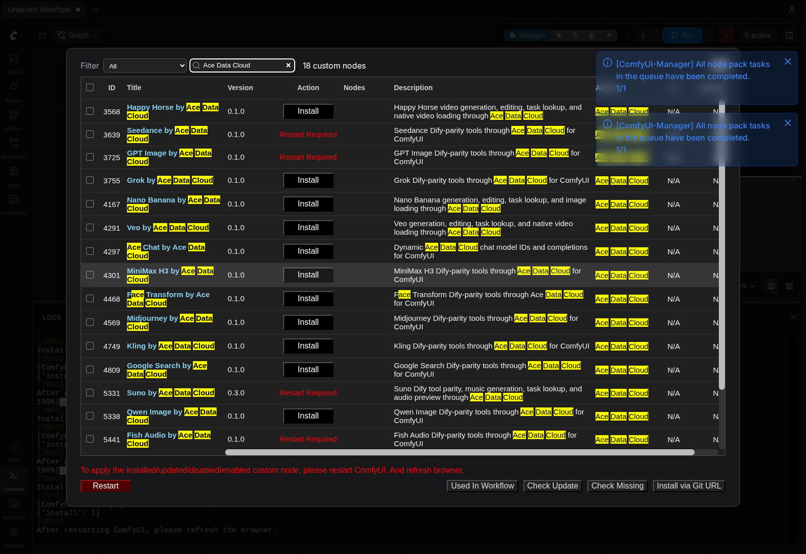
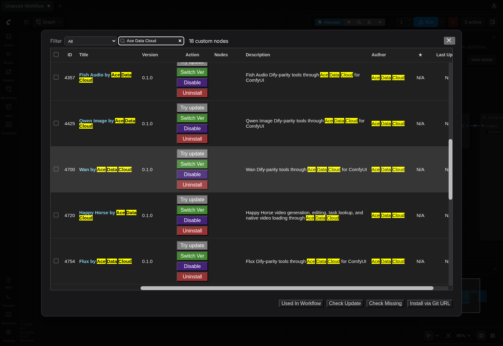

# Ace Data Cloud 的 ComfyUI Happy Horse（HappyHorse） 节点

使用 Ace Data Cloud 账户生成或编辑视频，按**同一个任务 ID**查询结果，再把完成的视频作为 ComfyUI 原生 `VIDEO` 使用。节点调用云 API，无需本地模型或显卡。收费以[当前 Happy Horse 价格](https://platform.acedata.cloud/models?utm_source=comfyui&utm_medium=referral&utm_campaign=evergreen&utm_content=happyhorsecomfyui_readme_zh_cn_pricing)为准。

[English guide](../README.md)

四个提交节点分别对应文生视频、首帧图生视频、1–9 张参考图生视频、视频编辑；另有单任务/批量查询和视频加载节点。当前 [HappyHorseDify](https://github.com/AceDataCloud/HappyHorseDify) 的 **7 个 model ID** 都在相应动作的选择器中。


## 当前版本与安装来源

本源码版本为 **0.1.2**，版本 ZIP 见 [GitHub Releases](https://github.com/AceDataCloud/HappyHorseComfyUI/releases)。下文 Registry 安装段保留 **2026-10-19 已核 Active 的 0.1.0**；该旧 ZIP 尚不包含本版更新的图文、示例或修复。需要本版时，使用对应 GitHub Release ZIP，或等 Registry 中准确的 **0.1.2** 变为 Active 后再手选该版本；不要用默认 nightly 代替已核 stable。

从 GitHub ZIP 安装：停止 ComfyUI，先备份已有同名节点目录，把 ZIP 内文件解压到 `ComfyUI/custom_nodes/happy-horse/`（不要多嵌套一层目录），在该目录运行 `python -m pip install -r requirements.txt`，然后重启并刷新。API Token 仍只配在实际启动进程环境中。GitHub ZIP 安装与 Registry/Manager 正式稳定版安装是不同路径。

## 安装与 Key

打开官方 [Happy Horse by Ace Data Cloud Registry 页面](https://registry.comfy.org/nodes/happy-horse)，或在 **Manager → Custom Nodes Manager** 搜索 **Happy Horse**；找不到时再搜 **Ace Data Cloud**。选择 **Happy Horse by Ace Data Cloud**，核对发布者 **acedatacloud** 和源码仓库 [`AceDataCloud/HappyHorseComfyUI`](https://github.com/AceDataCloud/HappyHorseComfyUI)，再点击 **Install**。在 **Select Version** 版本对话框明确选择已批准的 Registry 稳定版 **0.1.0**；普通对话框可能默认高亮 **nightly**，本教程不要直接接受该选项。保留依赖自动安装。出现 **Restart Required** 后重启 ComfyUI，并刷新浏览器。Registry ID 为 `happy-horse`。





以上原图来自 **2026-10-16、Linux ComfyUI 0.41.0** 的发布者品牌搜索安装验收，不是本轮新生成，也不是服务词搜索实拍；见[图片来源与边界](screenshot-sources.json)。

这条 Registry 稳定版安装路径已于 **2026-10-16 在原版 Linux CPU ComfyUI 0.41.0** 验证；该次安装验收没有提交生成或聊天请求。更新的宿主版本及每个收费动作仍需分别验证，模型可用性与价格以当前服务规则为准。

## 注册并获取 API Token

### 复制或创建自己的 API Token

Ace 应用页与其他集成共用：图中 **1** 复制已有 Token，**2** 打开**管理 Key**，再选**创建**。新账户先注册/登录并初始化**通用应用**；确认本服务权限、当前价格、余额、有效期和允许的 API 限制。


以上是 **2026-10-08** 的真实脱敏 Ace 控制台原图，复用自 SunoDify；第二图示例名为 `Dify tutorial`，此处请命名为 `ComfyUI`。本次未创建凭据。Token 只配在**启动 ComfyUI 的进程环境变量** `ACEDATACLOUD_API_KEY` 中并重启；节点没有图示的 Key 输入框，不要贴进提示词、JSON 参数或工作流文件。其他终端的 export 不会配置已经运行的 Desktop 进程。

1. 登录 [Ace Data Cloud → 应用](https://platform.acedata.cloud/console/applications?utm_source=comfyui&utm_medium=referral&utm_campaign=evergreen&utm_content=happyhorsecomfyui_readme_zh_cn_api_key)。新账户没有通用应用时，先选择**初始化通用应用**。
2. 打开**通用应用**，确认已开通本节点使用的服务。单服务应用的 Key 只限该服务。可复制已有 API Key；需要独立 Key 时，选择**管理 Key → 创建**，命名为 `ComfyUI`。
3. 只复制 Token 字符串，不加 `Bearer ` 或引号。平台管理 Token 不能代替节点调用 API 的 Key。若启用**允许的 API**限制，需同时包含工作流用到的提交和任务查询路径；收费动作前核对当前价格与 Credits 余额。

源码安装：

```bash
cd /path/to/ComfyUI/custom_nodes
git clone https://github.com/AceDataCloud/HappyHorseComfyUI.git
cd HappyHorseComfyUI
python -m pip install -r requirements.txt
```

要求 ComfyUI 0.39.0 或更新版本。将有 Happy Horse 权限的 Key 放在**实际 ComfyUI 进程环境**的 `ACEDATACLOUD_API_KEY`（也接受 `ACEDATACLOUD_API_TOKEN`），然后重启。限制路径时允许 `/happyhorse/videos` 和 `/happyhorse/tasks`。不要把 Key 写进工作流、仓库或截图。

## 操作

导入 [01-submit-text-to-video.json](../examples/01-submit-text-to-video.json)，选择模型和价格后只运行一次，记录任务 ID。文生视频和参考图生视频支持比例；首帧图生视频跟随图片比例；视频编辑的时长由输入视频决定。参考图可写 JSON 数组或每行一条公开 HTTPS URL。

导入 [02-retrieve-and-save.json](../examples/02-retrieve-and-save.json)，填入**同一个任务 ID**。工作流为 **Retrieve Task → Load Video → Save Video**。若 240 秒后仍为 pending，只重跑查询工作流。批量查询节点可只读查询 1–20 个已有 ID。

提交超时或 HTTP 5xx 时，先到 [Ace Data Cloud 控制台](https://platform.acedata.cloud/console/applications?utm_source=comfyui&utm_medium=referral&utm_campaign=evergreen&utm_content=happyhorsecomfyui_readme_zh_cn_api_key)按任务或 Trace ID 查请求记录，再决定是否重提。查询和媒体下载不应新增视频生成账单。详见[隐私说明](PRIVACY.md)。

查询节点每次队列执行都会重新读取同一任务，不复用旧pending结果；收费提交在输入不变时仍保留缓存，避免查询时重发收费生成。导入或运行工作流前先关闭自动队列/自动运行，提交图只明确运行一次。
